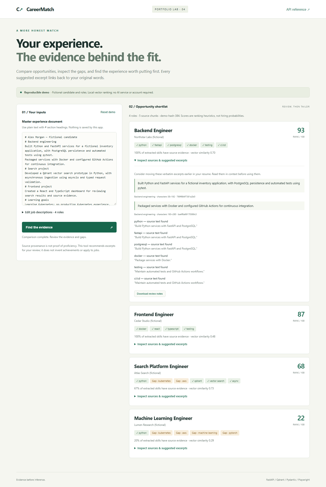
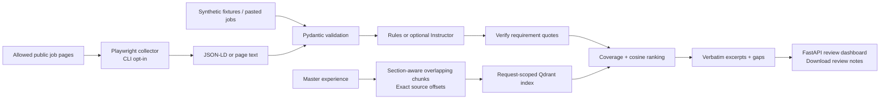

# CareerMatch Engine

[](https://github.com/dileepreddy27/careermatch-engine/actions/workflows/ci.yml)

**Find the experience behind the fit.** An evidence-linked job matcher that compares job requirements with a master experience document, surfaces gaps, and recommends verbatim resume excerpts for human review.

Most resume optimizers can make plausible claims that the candidate never supplied. CareerMatch takes a conservative approach: every suggestion includes its original section, exact quote, stable chunk ID, and character offsets. It can prioritize existing evidence; it does not invent achievements, proficiency, or metrics.

> Portfolio prototype · synthetic demo · no accounts, API keys, GPU, or database server required. The default vector encoder uses feature hashing, **not a trained semantic model**. Optional neural embeddings and LLM extraction are separate integrations.



[Mobile screenshot](docs/screenshots/mobile.png) · [Verification record](docs/VERIFICATION.md)

## Try the complete demo

Requires Python 3.11+; verification uses Python 3.11.

```bash
git clone https://github.com/dileepreddy27/careermatch-engine.git
cd careermatch-engine
python -m venv .venv
# macOS / Linux
source .venv/bin/activate
# Windows PowerShell instead: .\.venv\Scripts\Activate.ps1
python -m pip install -c constraints.txt -e '.[dev,browser,llm]'
python -m uvicorn careermatch.api:app --host 127.0.0.1 --port 8000
```

Open [localhost:8000](http://localhost:8000). Select **Find the evidence**, expand a role, inspect the source quotes and gaps, then download review notes. The demo contains fictional Alex Morgan and four fictional employers. Edit the experience document or job JSON and rerun it. [Interactive API docs](http://localhost:8000/docs) are included.

For a minimal installation without browser/LLM/test packages, use `python -m pip install -c constraints.txt -e .`. The dashboard and CLI demo need no browser automation runtime.

```bash
python -m careermatch.cli demo --output work/demo-result.json
python -m careermatch.cli match careermatch/fixtures/demo.json --output work/matches.json
```

The JSON input schema is `{ "resume": "plain text with # headings", "jobs": [{ "id": "unique-id", "title": "...", "company": "...", "text": "job description", "source": "optional URL" }] }`. A document must contain at least 20 characters; jobs must contain at least 20 description characters. See the bundled fixture for a complete example.

## Architecture



| Layer | Implemented behavior |
| --- | --- |
| Python / FastAPI | Typed API, bounded input schema, two matching slots per process, local dashboard |
| Pydantic | Strict models, duplicate job rejection, quote validation, bounded strings/lists |
| Qdrant client | Actual in-memory vector collection per request; cosine queries and explicit cleanup |
| Document processing | Section tracking, overlapping windows for long lines, stable IDs, exact Unicode offsets |
| Ranking | 75% extracted-skill coverage + 25% positive top-chunk cosine; zero for unrecognized requirements |
| Playwright / asyncio | Opt-in collection, max 8 concurrent workers, per-host serialization, robots checks, retries, deduplication, partial results |
| Instructor | Optional OpenAI-backed schema extraction with deterministic source checks; no credentials required by default |
| FastEmbed | Optional BGE-small neural encoder; downloads model weights on first use |
| Frontend | Responsive HTML/CSS/JavaScript, source inspection, gap labels, Markdown export, no frontend build step |

[Design decisions and operating boundaries](docs/ARCHITECTURE.md) explain the tradeoffs.

## Optional integrations

### Browser collection

```bash
python -m pip install -c constraints.txt -e '.[browser]'
python -m playwright install chromium
# Replace the example host/path with a public page you have permission to collect.
python -m careermatch.cli scrape https://careers.example.org/jobs/123 \
  --allow-host careers.example.org --concurrency 4 --output work/collected.json
```

On PowerShell, enter the scrape command on one line. The output includes `jobs`, per-URL `errors`, and `duplicates`. Copy its `jobs` array into a match request alongside your `resume`. Collection is CLI-only: the web app cannot navigate supplied URLs. HTTPS, exact host allowlists, public DNS, and an available robots policy are required. Redirects and cross-host resources are blocked; some portals will not render correctly. No portal coverage or large-scale throughput is claimed.

### Semantic embeddings

```bash
python -m pip install -e '.[semantic]'
python -m careermatch.cli match careermatch/fixtures/demo.json --semantic
```

This uses FastEmbed's `BAAI/bge-small-en-v1.5` CPU model instead of feature hashing. It needs network access for the initial model download. It is an implemented optional adapter, not part of the credential-free verification evidence. Scores still require human interpretation.

### Instructor extraction

Install `.[llm]`, set `OPENAI_API_KEY` and `CAREERMATCH_LLM_MODEL` in your shell, and add `--llm` to the `match` command. The model value is an OpenAI model ID supported by your account. This sends **job descriptions only** to the provider and can incur charges. Missing configuration fails explicitly. The UI always uses local rules. No paid provider call is part of this project's recorded verification.

Extracted quotes must occur in the source and explicitly contain the skill; unsupported labels and duplicate skills are rejected. This protects provenance, but cannot establish that the model understood the job correctly. The underlying patterns follow [Instructor's provider interface](https://python.useinstructor.com/concepts/from_provider/) and [Qdrant's local client](https://github.com/qdrant/qdrant-client).

## Verification

```bash
python -m playwright install chromium
python -m ruff check .
python -m ruff format --check .
python -m pytest -q
python scripts/browser_check.py
```

CI installs Chromium with Linux system dependencies, runs the tests and browser checks, and uploads screenshots plus the synthetic match result. [Verification evidence](docs/VERIFICATION.md) records actual local results, fixture ranks, and unverified integrations.

Tests cover source offsets, long-line coverage, deterministic IDs, ranking on fixtures, negated experience, candidate isolation, unrecognized requirements, fabricated extraction rejection, input validation, collection concurrency/retries/timeouts/deduplication, private-address rejection, and real Chromium fixture rendering. The UI check exercises matching, evidence inspection, download, narrow-screen layout, recoverable input errors, and safe rendering of untrusted text.

## Limitations that matter

- The default extractor recognizes a small English skill ontology. Keyword occurrence is not proficiency, and the conservative line-level negation filter can miss valid evidence. Scores do not account for compensation, seniority, location, work authorization, years of experience, or mandatory versus preferred requirements.
- Resume tailoring means selecting/reordering original excerpts. There is no generative rewriting, PDF parsing, document export, application submission, or automated outreach.
- This is a local single-user prototype. It has no authentication, durable queue, persistent Qdrant server, or production gateway. Do not expose it publicly with real resumes. Field limits do not replace ingress body-size and connection limits.
- Browser network validation is defense in depth, not a complete egress sandbox. DNS rebinding, hostile pages, provider terms, and source-specific compatibility require additional controls before a hosted scraper.
- Fixture tests demonstrate implemented behavior, not recruiter outcomes, model accuracy, fairness, or hundreds-of-portals scalability. No production deployment is claimed.

## Engineering highlights for a resume

- Built a FastAPI/Qdrant job-matching pipeline with section-aware resume chunking, requirement coverage ranking, and source-linked excerpts that preserve exact candidate text.
- Implemented a bounded asynchronous Playwright collector with per-host pacing, robots checks, deduplication, partial failure handling, and deterministic tests.
- Added Pydantic-validated optional LLM extraction and a responsive review interface, with API and Chromium checks in GitHub Actions.

All fixtures are original fictional examples distributed under the [MIT license](LICENSE). Roadmap: labeled relevance evaluation, source-specific collectors, isolated network egress, pinned semantic-model integration tests, and authenticated persistence before handling real multi-user data.
